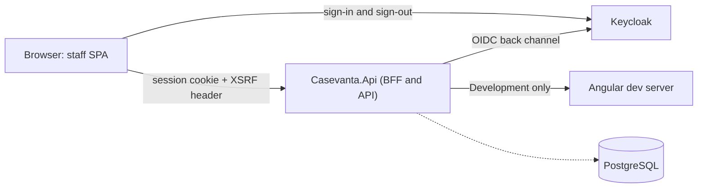

# Casevanta

[](https://github.com/MattWUchanski/casevanta/actions/workflows/ci.yml)
[](LICENSE)

Casevanta is a customer operations and assurance platform, built as a portfolio project. Its central
workflow connects customer applications, employee work, verification, inspection, findings,
remediation and independent audit. It runs on a modular .NET backend with Angular frontends. Every
product, customer and user in it is fictional, and all data is synthetic.

**Status:** the bootstrap phase is complete. The repository has:

- a secure backend for the browser (BFF);
- the staff web application shell;
- Keycloak sign-in with roles;
- local orchestration with Aspire;
- five layers of automated tests.

Business modules come next, starting with application intake and verification as described in the
[initial plan](docs/product/initial-plan.md).

## Quick start

Prerequisites (`scripts/bootstrap.sh` checks them):

| Tool | Version |
|---|---|
| .NET SDK | 10.0.401 or later in the 10.0 line (`global.json`) |
| Node.js | 22.22.3+, 24.15+ or 26+ (`frontend/.nvmrc`; Angular 22's supported range) |
| pnpm | 12 (`packageManager` in `frontend/package.json`) |
| Docker | Running |
| Aspire CLI | 13.6.1 or later |
| gitleaks | Any recent version (pre-commit secret scan) |

```bash
scripts/bootstrap.sh   # checks prerequisites, installs dependencies, trusts the dev certificate, installs git hooks
scripts/dev.sh         # starts PostgreSQL, Keycloak, the Angular dev server and the BFF with Aspire
scripts/test.sh        # runs every automated check; --fast skips containers and the browser
```

Then open <https://localhost:5001> and sign in, for example as `victor.verifier`. The development
users and their password are in [infra/keycloak/README.md](infra/keycloak/README.md).

| URL | What |
|---|---|
| <https://localhost:5001> | The staff application, served by the BFF |
| <https://localhost:17032> | Aspire dashboard: logs, traces, metrics and resource health (the login link is printed on start) |
| <https://localhost:8080> | Keycloak, realm `casevanta-workforce` |
| <http://localhost:4201> | Angular dev server; the BFF proxies it, so there is no need to open it directly |

## Architecture



- The browser never sees tokens. The BFF holds them in an encrypted, HttpOnly session cookie. It
  enforces antiforgery on API calls and serves the app with a per-request CSP nonce.
- Keycloak authenticates and supplies coarse roles. Casevanta's backend decides what each role may
  do ([ADR-0006](docs/adr/0006-identity-versus-authorization-and-tenancy.md)).
- The backend is a modular monolith, and its module boundaries are enforced by architecture tests
  ([ADR-0005](docs/adr/0005-module-boundaries.md)).

Details are in the [architecture overview](docs/architecture/overview.md), the
[threat model](docs/architecture/threat-model.md), the
[configuration reference](docs/architecture/configuration.md) and the
[architecture decision records](docs/adr/README.md).

## Repository layout

Each stack has its own folder and toolchain root. The repository root holds only what the stacks
share: CI, git hooks, formatting rules, infrastructure, scripts and documentation
([ADR-0012](docs/adr/0012-repository-layout.md)).

| Path | Contents |
|---|---|
| `backend` | .NET solution `Casevanta.slnx`, shared build settings and central package versions |
| `backend/src/Casevanta.Api` | BFF and API host, the composition root for business modules |
| `backend/src/Casevanta.AppHost` | Aspire orchestration of the local topology |
| `backend/src/Casevanta.ServiceDefaults` | OpenTelemetry, health checks, service discovery and resilience |
| `backend/tests` | API and security tests (suite A), distributed tests (suite C) and architecture rules |
| `frontend` | pnpm and Nx workspace: `package.json`, `nx.json` and the TypeScript, ESLint and Tailwind configuration |
| `frontend/apps/staff-web` | Angular 22 staff application (zoneless, signals, spartan-ng on Tailwind CSS 4) |
| `frontend/apps/staff-web-e2e` | Playwright browser journeys (suite B) |
| `frontend/libs/shared/ui` | spartan-ng components owned by the repository |
| `infra/keycloak` | Keycloak realm import and development users |
| `docs` | Product plan, architecture, threat model and ADRs |
| `scripts` | Bootstrap, run, test, reset and repository protection scripts |

Run `dotnet` from the repository root. The root `global.json` pins the SDK and the test runner for
the whole repository. Run `pnpm` and `nx` inside `frontend`, or from the root with `pnpm -C frontend`.
Prettier covers the whole repository: `pnpm -C frontend format` fixes formatting, and the
pre-commit hook does the same for staged files.

## Tests

| Layer | What it proves | Command |
|---|---|---|
| A: API and security | BFF behaviour in memory: access rules, antiforgery, headers, OIDC, problem details | `dotnet test --project backend/tests/Casevanta.Api.Tests/Casevanta.Api.Tests.csproj` |
| Architecture rules | Module and layering rules | `dotnet test --project backend/tests/Casevanta.Architecture.Tests/Casevanta.Architecture.Tests.csproj` |
| Frontend unit | Interceptor, cookie reader, shell and page contracts | `pnpm -C frontend nx test staff-web` |
| C: distributed | The real topology with Keycloak and PostgreSQL (Docker) | `dotnet test --project backend/tests/Casevanta.AppHost.Tests/Casevanta.AppHost.Tests.csproj` |
| B: browser journeys | Sign-in, protected calls, roles, sign-out and CSP checks in a real browser (Docker) | `pnpm -C frontend nx e2e staff-web-e2e` |

CI (`.github/workflows/ci.yml`) runs five jobs on every push and pull request:

- `secrets` scans the full history with gitleaks.
- `backend` checks formatting and runs suite A and the architecture rules.
- `web` checks the formatting of the whole repository, then runs lint, unit tests and the production
  build.
- `integration` runs suite C.
- `e2e` runs suite B.

## Security

- No real credentials are in the repository. The OIDC client secret is generated per machine, and
  the development users exist only in the local Keycloak container.
- Every commit is scanned by a gitleaks pre-commit hook and in CI. GitHub secret scanning with push
  protection, Dependabot and CodeQL are enabled (`scripts/github-protect.sh`).
- The [threat model](docs/architecture/threat-model.md) maps each threat to the tests that keep its
  mitigation in place, and lists the known gaps.

## Attribution and licence

Casevanta started from damienbod's
[bff-openiddict-aspnetcore-angular](https://github.com/damienbod/bff-openiddict-aspnetcore-angular)
sample, imported at commit `08a8d38` under the Apache License 2.0 and described in
[Secure Angular application using OpenIddict and ASP.NET Core with BFF](https://damienbod.com/2023/09/25/secure-angular-application-using-openiddict-and-asp-net-core-with-bff/).
Its security headers come from
[NetEscapades.AspNetCore.SecurityHeaders](https://github.com/andrewlock/NetEscapades.AspNetCore.SecurityHeaders),
and its development proxy from [YARP](https://github.com/dotnet/yarp). See [NOTICE](NOTICE).

Casevanta is licensed under the [Apache License 2.0](LICENSE).
