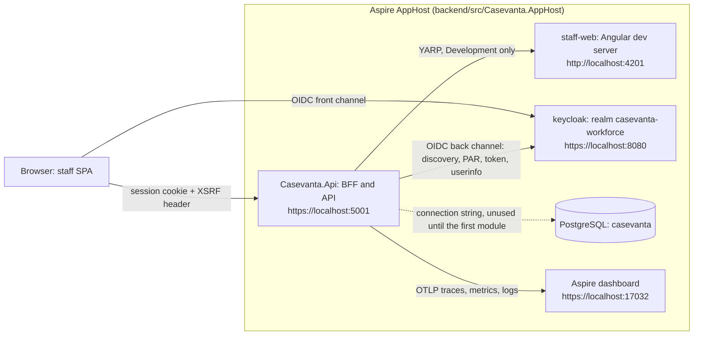

# Architecture overview

| | |
|---|---|
| Status | Cleaning phase: inherited BFF restructured, Aspire orchestration in place, Keycloak as the workforce identity provider |
| Updated | 2026-10-10 |

## Local topology

`scripts/dev.sh` (`aspire run`) starts everything below. The browser only ever talks to the BFF
origin and to the identity provider.

| Path | Role |
|---|---|
| `backend/src/Casevanta.Api` | Composition root: the BFF (cookie session, OIDC, antiforgery, CSP nonce, development proxy) and the API endpoints. Business modules will plug in here without depending on it (ADR-0005). |
| `backend/src/Casevanta.AppHost` | Aspire orchestration of the local topology. Not a runtime dependency of the API (architecture rule AR01). |
| `backend/src/Casevanta.ServiceDefaults` | OpenTelemetry, health checks, service discovery and HTTP resilience for every .NET service. |
| `apps/staff-web` | Angular 22 staff SPA (zoneless, signals, spartan-ng on Tailwind 4). |
| `libs/shared/ui` | spartan-ng helm components owned by the repository. |
| `infra/keycloak/realms` | Keycloak realm import: roles, the `staff-web` client and the development users. |

## Test layers

| Layer | Suite | What it proves | Needs | CI job |
|---|---|---|---|---|
| ASP.NET Core integration | A, `backend/tests/Casevanta.Api.Tests` | BFF behaviour in memory: access rules, antiforgery, hardening headers, OIDC challenge and logout | .NET | `backend` |
| Architecture rules | AR, `backend/tests/Casevanta.Architecture.Tests` | Dependency rules from ADR-0005 | .NET | `backend` |
| Frontend unit | Vitest, `apps/staff-web` | Interceptor origin rules, cookie reader, shell and home contracts | Node.js | `web` |
| Distributed integration | C, `backend/tests/Casevanta.AppHost.Tests` | The AppHost starts the real topology (containers included); health and contract | Docker | `integration` |
| Browser journeys | B, `apps/staff-web-e2e` | Real browser through Keycloak, the BFF and the SPA: sign-in, protected calls, roles, sign-out, CSP guard | Docker, Node.js | `e2e` |

The API stays testable without Aspire: suite A hosts it in memory, and suite C is the only layer
that starts the distributed application.

## Observability checklist

Run on 2026-10-10 against the OpenIddict topology: `aspire start`, suite B against the running
stack, then `aspire otel spans api` and `aspire otel logs api` exported as JSON.

| Check | Result |
|---|---|
| Incoming requests produce server spans | Pass (`GET /_Host`, `GET api/User`, `GET api/DirectApi`, `POST /signin-oidc`, …) |
| The host page's fetch of `index.html` is a correlated client span | Pass (`GET /_Host` → `GET http://localhost:4201/index.html`, same trace) |
| The YARP development proxy forwards with a correlated client span | Pass (`GET /styles.css` → `GET http://localhost:4201/styles.css`, same trace) |
| The OIDC back channel is traced | Pass (`POST /signin-oidc` → `POST https://localhost:44318/connect/token`, same trace) |
| Structured logs carry trace and span IDs | Pass (393 of 399 log records) |
| No tokens, client secret, authorization code, cookie value, password or user e-mail in telemetry | Pass (none in 385 spans and 399 log records) |
| Health probes stay out of traces | Pass (`/health` and `/alive` are filtered in ServiceDefaults) |
| URL query strings | Exported unredacted. The only OIDC value seen is the encrypted `state` of the sign-out callback (threat model gap G13) |

### Re-run on the Keycloak topology (2026-10-10)

| Check | Result |
|---|---|
| Login is traced with its back-channel calls | Pass (`GET /api/Account/Login` → discovery, signing keys and `POST …/ext/par/request`, same trace) |
| The sign-in callback is traced with token redemption | Pass (`POST /signin-oidc` → `POST …/token` and `GET …/userinfo`, same trace) |
| Structured logs carry trace and span IDs | Pass (572 of 578 log records) |
| No tokens, client secret, authorization code, cookie value, password or user e-mail in telemetry | Pass (552 spans, 578 log records) |
| URL query strings | Only development-server parameters (`c`, `t`, `v` and Vite's HMR `token`); no OIDC values |
| Keycloak's own spans | Not yet: the integration enables the `opentelemetry` feature and the OTLP variables, but Keycloak's tracing switch is off and its JVM does not trust the dashboard's development certificate. The BFF side of every exchange is traced. |

Re-run this checklist whenever a new service or outgoing call is added.
