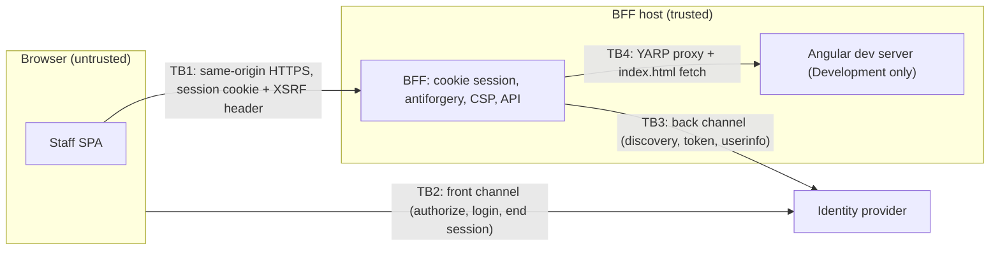

# Threat model: browser-facing BFF

| | |
|---|---|
| Status | Baseline, written before any change to the inherited BFF |
| Updated | 2026-10-10 |
| Scope | The ASP.NET Core BFF (`bff/server`, becoming `backend/src/Casevanta.Api`), the staff SPA it serves, and the identity provider it trusts (the inherited OpenIddict server today, Keycloak later) |
| Method | Data flows and trust boundaries, then threats per boundary (STRIDE category in brackets). Every mitigation names the automated test that keeps it true. |

Test IDs refer to `backend/tests/Casevanta.Api.Tests` (A, in-memory API and header tests) and to
`e2e/` (B, browser journeys). Update this document whenever a test ID, a mitigation or a gap changes.

## System and trust boundaries

| Boundary | Crossing | Notes |
|---|---|---|
| TB1 | Browser ↔ BFF | The SPA talks only to its own origin. Tokens never cross this boundary; the browser holds an encrypted, HttpOnly session cookie. |
| TB2 | Browser ↔ identity provider | Authorization request, login and consent pages, form_post response, end-session redirect. |
| TB3 | BFF ↔ identity provider | Server-to-server: discovery, code redemption with the client secret, userinfo. |
| TB4 | BFF ↔ dev server | Development only. Mapped only when the environment is Development. |
| TB5 | Repository and CI ↔ public | The repository is public; anything committed is published. |

## Assets

| Asset | Where it lives | Why it matters |
|---|---|---|
| Session cookie `.AspNetCore.Cookies` | Browser, encrypted with ASP.NET Core Data Protection | Contains the authentication ticket and, because `SaveTokens = true`, the ID, access and refresh tokens. |
| Antiforgery pair `__Host-X-XSRF-TOKEN` + `XSRF-RequestToken` | Browser | Proves a state-changing request came from the SPA. |
| OIDC client secret | BFF configuration | Authenticates the BFF at the token endpoint. |
| Data Protection keys | BFF host (user profile by default) | Decrypt every session cookie. |
| User identity and claims | Session ticket, `/api/User` | Personal data; drives authorization. |
| Business records and evidence | Future modules and database | Out of scope until the first module exists. |

## Threats, mitigations and tests

| ID | Threat | Mitigation in place | Verified by |
|---|---|---|---|
| T1 | [I/E] Cross-site scripting steals tokens or rides the session | Tokens stay server-side; session cookie is HttpOnly; strict CSP with a fresh per-request nonce injected into the host page; Angular template sanitisation | A05, A06, A07, A17, B05, B08 |
| T2 | [T] Cross-site request forgery against the API | Session cookie SameSite=Lax; double-submit antiforgery (`__Host-` HttpOnly cookie + `X-XSRF-TOKEN` header) bound to the signed-in user; global `AutoValidateAntiforgeryToken`; the data endpoint validates even GET | A06, A09, A10, A19, B06 |
| T3 | [S] Login CSRF, authorization-code injection or replay | Authorization code flow with PKCE (S256), `state` and `nonce`, HttpOnly + Secure correlation and nonce cookies | A04, B05 |
| T4 | [S] Open redirect through `returnUrl` after login | Absolute http(s) URLs are reduced to their path; relative ones are anchored at `/`; protocol-relative, backslash and control-character forms fall back to `/` | A15, A20 |
| T5 | [T] Clickjacking | `X-Frame-Options: DENY` and `frame-ancestors 'none'` | A07, A17 |
| T6 | [S] Session hijacking, fixation or an overlong session | Secure, HttpOnly, SameSite=Lax session cookie issued only after a completed OIDC sign-in | B05 |
| T7 | [E] Unauthenticated or unauthorised API access | `[Authorize]` on protected endpoints; `/api` requests get 401 instead of a login redirect; unknown `/api` routes get 404 | A01, A02, A03, A08, A18, B02 |
| T8 | [S] Logout leaves a live session at the BFF or identity provider | Logout deletes the session cookie and redirects to the end-session endpoint with `id_token_hint` and a registered `post_logout_redirect_uri` | A11, B07 |
| T9 | [I] Information disclosure through errors, headers or routing | No `Server` header; developer exception page only in Development; unknown API routes return 404, client routes return the host page | A03, A16, B03, B04 |
| T10 | [I/T] Transport downgrade or mixed content | HTTPS redirection; HSTS for one year (with `preload` on `/api`) outside Development; `block-all-mixed-content` | A07, A17 |
| T11 | [I] Secrets published through the public repository | Sanitised import (no private key, no user database); gitleaks over the full history in CI; GitHub secret scanning with push protection | CI job `secrets` |
| T12 | [E] The development proxy exposed outside Development | YARP routes are mapped only in Development | Inspection (Program.cs) |
| T13 | [I] Cross-origin reads and side channels | COOP, COEP and CORP set to same-origin / require-corp; no CORS policy, so no cross-origin API access | A07, A17 |
| T14 | [All] Vulnerable dependencies | Dependabot alerts and security updates; CodeQL default setup | GitHub settings (`scripts/github-protect.sh`) |

## Known gaps

Each gap is either fixed in a planned step or accepted with a reason. A test marked "known gap"
documents current behaviour and must change when the gap closes.

| ID | Gap | Threat | Plan |
|---|---|---|---|
| G1 | ~~Protocol-relative return URLs (`//evil.example`) pass the open-redirect guard~~ | T4 | Fixed 2026-10-10: only site-relative paths are accepted, everything else falls back to `/` (A20) |
| G2 | Logout ignores antiforgery (`[IgnoreAntiforgeryToken]`), so another site can force a logout | T2 | Fix with the session work in the Keycloak step; A12 documents it |
| G3 | Default 14-day sliding cookie lifetime; tickets are self-contained, so a copied cookie stays valid until it expires, even after logout | T6 | Explicit lifetime in the Keycloak step; server-side ticket store evaluated in ADR-0008 |
| G4 | `IdentityModelEventSource.ShowPII = true` in every environment (BFF and IdentityProvider) | T9 | Development-only in the restructuring step; the IdentityProvider is removed with Keycloak |
| G5 | CSP keeps `'unsafe-inline'` next to the nonce (ignored by nonce-aware browsers) and `style-src 'unsafe-inline'` | T1 | Re-evaluated when the new UI lands |
| G6 | Authorization is authentication-only: no roles or policies | T7 | First policy in the Keycloak step; model in ADR-0006 |
| G7 | The IdentityProvider depends on packages with known high-severity advisories (`SQLitePCLRaw.lib.e_sqlite3` 2.1.11, `Microsoft.OpenApi` 2.4.1) | T14 | Development-only; removed together with the IdentityProvider |
| G8 | A sample OIDC client secret is committed in `appsettings.json` and the IdentityProvider seeding | T11 | Replaced by a generated, per-machine Aspire parameter in the Keycloak step |
| G9 | Data Protection keys use the default per-user location; containers would lose them on restart | T6 | ADR-0008 |
| G10 | The development identity provider will run over plain HTTP inside the local container network | T10 | Development-only; metadata must be HTTPS outside Development |
| G11 | No back-channel logout | T8 | Out of scope for this phase |
