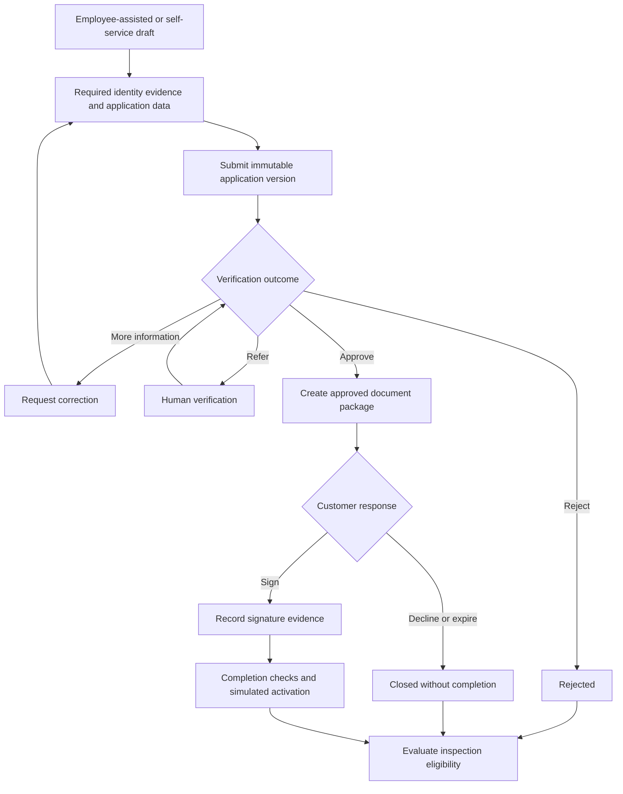
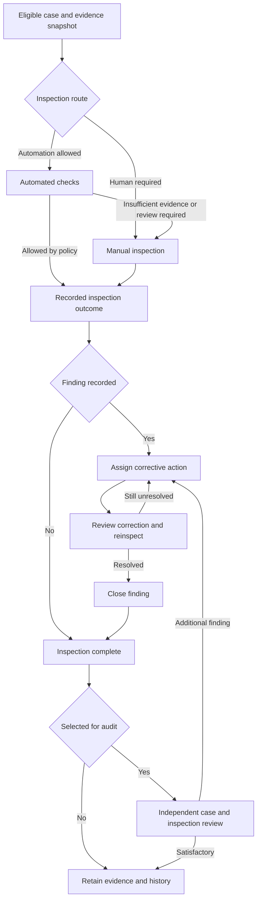

# Customer Operations and Assurance Platform: initial plan

> Source: the product plan Casevanta started from (baseline as of 10 October 2026), kept as written.
> Decisions taken since are recorded in [the ADRs](../adr/README.md).

Build a customer operations and assurance platform over 6–12 months. Its central workflow connects customer applications, employee work, verification, customer agreement, process inspection, findings, remediation, and independent quality review.

Start with one fictional product, synthetic data, a modular .NET backend, and a working employee-assisted journey. Add automation and additional channels to that journey as it becomes reliable. CRM features should support this lifecycle: customer profiles, case history, documents, interactions, tasks, and communication.

This is the proposed baseline as of 10 October 2026. The roadmap assumes one developer contributing roughly 10–15 focused hours each week. Dates are indicative; exit criteria decide when to move on. At a lower weekly commitment, keep the order and extend the timeline.

## Product scope and first release

Use a fictional personal-loan application as the first product. Product eligibility rules, identity checks, signing, and activation are explicit demonstrations with synthetic data. No real lending or money movement is needed.

The initial release should demonstrate three complete stories: an approved application, a rejected application, and an application with a process finding that is corrected and reinspected.

| Area | Initial scope | Expansion |
| - | - | - |
| Customer | View own application, supply missing information, view documents, complete simulated signing | Self-service application, account registration, mobile capture, notifications |
| Employee | Customer profile, application draft, document upload, interaction record, submission, corrective actions | Rich interaction timeline, audio, assisted recommendations |
| Verifier | Claim a case, approve, reject, or request information with reasons | Rule-based routing and external provider adapters |
| Inspector | Review evidence, record findings, request correction, reinspect | AI assistance, configurable checklists, workload allocation |
| Auditor | Sample cases and assess the process and inspection | Audit campaigns, trends, control-level findings |
| Administrator | Roles, team membership, product settings, versioned inspection checklist | Tenant provisioning, richer configuration |
| Reporting | Queue age, application outcomes, open findings, overdue remediation | Replayable analytical projections and richer comparisons |

Employee, verifier, inspector, auditor, and administrator are initially areas within one staff application. The customer application is separate because its audience, document visibility, and experience differ. Reporting is a set of views before it becomes a separate analytical system.

Exclude generic marketing automation, sales opportunity management, arbitrary visual workflow designers, multiple lending products, native mobile, and production identity or signature integration from the first release.

## Correct the process boundaries

Application verification asks whether the application can proceed. Inspection asks whether the customer interaction and employee process were handled correctly. Audit initially means independent quality review of the case and its inspection; an organisation-wide internal-audit programme is a separate future scope.

| Process | Outcomes to model | Authority |
| - | - | - |
| Application verification | Approve, reject, request information, refer to a human | Product policy or authorised verifier |
| Inspection | No finding, finding, insufficient evidence | Inspection policy or authorised inspector |
| Audit | Satisfactory, additional finding, remediation required | Independent auditor |
| Remediation | Assigned, action submitted, reinspection required, closed | Action owner and independent reviewer |

Automation coverage and business outcome are separate. An automated check can confidently find a problem. It can also lack sufficient evidence. Do not use one yes/no question to represent both.

Account authentication and customer identity verification are also separate. Both employee-assisted and self-service channels must collect the identity evidence required by the chosen product policy. Preserve both the origin channel and subsequent employee participation; a case started by a customer may later receive employee assistance.

Replace the ambiguous “employee confirms” step with a named product rule: completion checks followed by simulated activation. Self-service cases do not necessarily require employee confirmation.

Include requests for information, resubmission, withdrawal, signature refusal, expiration, and failed external operations. A timeout is an operational condition requiring retry or review; it is not automatically a business rejection.

## Application lifecycle

The diagram shows the main business branches. Signing refusal, expiration, cancellation, and operational retry are additional explicit transitions in the state model.

Treat the return from human verification as a final human outcome: approve, reject, or request information. It must not automatically refer back to the same queue.

Bind approval and signing to an exact application and document-package version. Material changes after approval require a new review and, where relevant, a new package and signature. Preserve the original versions and decisions.

Inspection eligibility is a policy decision across relevant outcomes, including rejected and withdrawn cases where customer interaction occurred. Early alerts may eventually run during an application, while final inspection still uses a defined evidence snapshot.

## Inspection audit and remediation

Automatically cleared cases remain eligible for audit sampling. Otherwise the system cannot independently measure defects missed by automation.

The initial application must support manual verification and manual inspection before LLM automation. Automatic findings should first appear as proposals for an inspector to accept, edit, or reject.

Keep audit selection reasons and sample populations. Start with a simple reproducible random sample plus explicit risk rules. Include cases passed by automation and cases from different outcomes; do not evaluate the model only on cases it referred.

Audit history, activity logs, and business audit are different concepts. A technical audit log records who changed what. An auditor’s review is a domain workflow with scope, evidence, conclusions, and corrective actions.

## Architecture and module ownership

Use one repository, two Angular applications introduced incrementally, one modular ASP.NET Core backend, and an independently runnable worker when asynchronous processing is needed. The BFF is a thin browser-facing boundary; business decisions stay inside the backend modules.

| Module | Owns |
| - | - |
| Customer and organisation access | Customer profiles, memberships, team scope, tenant context |
| Applications | Drafts, product selection, submission versions, lifecycle transitions |
| Verification | Check results, requests for information, manual decisions |
| Documents and signing | Document metadata, immutable versions, signature requests and evidence |
| Inspections | Inspection cases, checklist results, proposed and confirmed findings |
| Audits | Selection rules, samples, case and inspection reviews |
| Remediation | Action ownership, corrective evidence, reinspection and closure |
| Reporting | Read models derived from business records or events |

These are code and ownership boundaries, not an instruction to create eight network services. Keep modules together until a concrete need justifies extraction. Documents and AI processing are the strongest first candidates because they have different latency, scaling, and failure behaviour.

Start with one PostgreSQL database for business modules and messaging persistence. Give modules ownership of tables and writes; avoid reaching into another module’s implementation. A physical schema per module is useful if it stays simple. Reporting may use explicitly designed read models.

Use ordinary transactions and explicit persisted states. A full event-sourced system is not required. Store business history and versioned evidence without pretending that a mutable database is tamper-proof.

Start with one tenant in the demo UI, but include tenant/organisation ownership in records and authorization rules where needed. Add a second tenant in isolation tests. Database-per-tenant provisioning is a later architectural experiment, with separate migration, connection, messaging, backup, and restore implications.

## Technology choices

| Layer | Baseline choice | Reason and timing |
| - | - | - |
| Frontend | Angular, TypeScript, Angular Material and CDK | Reuse existing expertise and spend learning time on architecture and product behaviour |
| Workspace | pnpm and Nx | Useful for customer and staff applications with shared UI and API-client libraries |
| Backend | .NET 10 LTS, ASP.NET Core, EF Core | Main domain and API implementation |
| Browser boundary | ASP.NET Core BFF with OIDC | Server-managed browser sessions and client-oriented endpoints |
| Identity | Keycloak | Local identity provider; separate customer and workforce clients and account policies |
| Database | PostgreSQL | Operational records, job state, message persistence, initial reporting |
| Documents | Azurite locally; Azure Blob Storage when deployed | Keep document bytes separate from database metadata |
| Async work | Wolverine; RabbitMQ with the first independent worker | Durable handoffs, retries, message handlers, transactional outbox/inbox |
| Local infrastructure | Docker Compose | One documented startup path, explicit ports, volumes, and health checks |
| Telemetry | OpenTelemetry and a compatible local viewer | Correlate HTTP requests, messages, worker execution, and failures |
| Tests | xUnit, Testcontainers, Playwright | Business invariants, integration with real infrastructure, end-to-end role journeys |
| Delivery | GitHub Actions; Azure deployment with infrastructure as code | Reproducible build, test, release, and operational demonstration |
| AI execution | Provider adapter; local model runner when introduced | Keep domain workflows independent of a specific model or hosting provider |
| Python | Dedicated document or AI worker later | Add it for OCR, transcription, evaluation, or data processing that benefits from its ecosystem |

.NET 10 is an active LTS release supported into November 2028 according to the [official support policy](https://dotnet.microsoft.com/en-us/platform/support/policy). Pin package and image versions when bootstrapping, then update deliberately.

[Nx’s Angular integration](https://nx.dev/docs/technologies/angular/introduction) supports monorepos, shared libraries, import boundaries, and build tooling. Use that first; independently deployed microfrontends are a different decision.

[Wolverine documents EF Core transactional inbox/outbox integration](https://wolverinefx.net/guide/durability/efcore/outbox-and-inbox) and a [RabbitMQ transport](https://wolverinefx.net/guide/messaging/transports/rabbitmq/). Validate the transaction boundary with the actual pinned versions. Do not assume cross-database atomicity or exactly-once external side effects.

[Azurite](https://learn.microsoft.com/en-us/azure/storage/common/storage-use-azurite) provides local Azure Storage emulation. Test the cloud adapter as part of deployment; an emulator is not identical to the production service. [OpenTelemetry](https://opentelemetry.io/docs/what-is-opentelemetry/) supplies vendor-neutral instrumentation for traces, metrics, and logs.

## BFF mobile and authorization

For the web applications, use browser sessions with Secure and HttpOnly cookies, appropriate SameSite settings, and CSRF protection. Keep upstream access and refresh tokens server-side. Separate workforce and customer authentication configuration and allowed operations. The backend must enforce ownership and permissions even if the BFF already authenticates requests.

Initially, BFF routes and domain APIs can live in one ASP.NET Core deployment with a clear code boundary. Extract deployments only when trust, release, scaling, or experience requirements justify them. Do not create a BFF for every staff role. The [BFF pattern guidance](https://learn.microsoft.com/en-us/azure/architecture/patterns/backends-for-frontends) describes both client-specific tailoring and its additional operational cost.

Start mobile access with a responsive customer website. Add installation/PWA support only when useful; sensitive customer documents and API responses should not be cached for offline use by default. Angular describes its [service worker](https://angular.dev/ecosystem/service-workers) as a basic caching utility, so advanced offline synchronization is a separate feature.

If camera capture, push notifications, or device integration become valuable, evaluate [Capacitor](https://capacitorjs.com/docs) around the customer frontend. A native client needs its own authentication design, normally an external system browser and authorization code with PKCE, following [OAuth for native applications](https://www.rfc-editor.org/rfc/rfc8252). Do not assume browser cookie behaviour transfers unchanged to mobile.

Start authorization with roles plus resource attributes: organisation, team, customer ownership, assignment, and process state. Enforce these invariants:

- A customer sees only their own cases and customer-visible documents.

- An employee acts within their permitted organisation and team.

- A reviewer cannot independently approve or inspect their own work.

- An auditor cannot silently rewrite the original employee or inspector decision.

- Administrative configuration access does not automatically grant customer-document access.

- Background workers apply the same tenant and evidence scope.

- Every consequential decision records actor, timestamp, reason, evidence version, and policy/model version where applicable.

Relationship-based authorization is a later option if delegation, sharing, and organisational relationships become hard to express. Model and test the authorization contract before choosing a graph authorization engine.

## First implementation sequence

The first objective is a working application and human verification. The next objective is the full customer handoff and assurance cycle.

| Order | Deliverable | Exit criterion |
| - | - | - |
| 1 | Employee creates and saves an application for a synthetic customer | Draft survives restart; unauthorized users cannot access it |
| 2 | Submit a frozen application version | Invalid submissions fail clearly; repeat submission cannot duplicate the business operation |
| 3 | Verifier claims and decides the case | Approve, reject, and request-information paths work; concurrent reviewers cannot overwrite one another |
| 4 | Customer views approved package and simulates signing | Only the approved version can be signed; stale or duplicate callbacks are handled |
| 5 | Complete case and create inspection | Retrying completion creates exactly one logical inspection |
| 6 | Inspector records a finding and requests correction | Evidence, reason, owner, due date, and history are visible |
| 7 | Employee responds and inspector reinspects | Finding closes only after an authorized review; original evidence remains |
| 8 | Auditor samples and reviews a completed case | Audit can include an automatically cleared case; audit findings lead to tracked action |
| 9 | Add deterministic automation to existing workflows | Automated results use the same decision contracts and can refer to humans |
| 10 | Add AI proposals and measure them | Each proposal cites evidence; held-out cases expose false negatives and unsupported claims |

For the first fortnight, at roughly 20–30 total hours, aim to complete orders 1–3 in a minimal staff interface. Do not interpret that as a promise to finish both portals and every integration in two weeks.

Days 1–2: choose the product, describe the three demo stories, define states and actor permissions, and write a short scope statement. Record decisions on module boundaries, identity versus authorization, and evidence versioning.

Days 3–4: establish the repository, minimal Angular staff app, .NET host, PostgreSQL, identity provider, Compose, and basic CI. Keep the customer app scaffold small or introduce it with the signing slice.

Days 5–7: implement employee draft creation and submission, server validation, authorization, persistence, and activity history.

Days 8–10: implement a manual verification queue, claim/assignment, approve/reject/request-information, optimistic concurrency, and one browser demonstration. If setup takes longer, preserve scope and move the calendar.

## Roadmap and milestone gates

| Period | Product milestone | Engineering evidence |
| - | - | - |
| Month 1 | Employee-assisted intake and manual verification for one product | Authenticated journey, versioned submissions, permission tests, CI, reproducible local setup |
| Months 2–3 | Customer signing handoff, completion, manual inspection, remediation, basic audit | Three complete demo stories, document versions, separate lifecycles, simple reporting |
| Months 4–6 | Asynchronous document processing and AI-assisted inspection | Outbox/inbox recovery, duplicate handling, traces, evaluation report, deployed demo |
| Months 7–9 | Select one major expansion: self-service/mobile or analytical event streaming | A complete additional journey or a replay/rebuild demonstration |
| Months 10–12 | Select one architecture expansion and harden the showcase | Tenant isolation, service extraction, orchestration, or Kubernetes with measured trade-offs |

By month 6, target a coherent, deployable core with documented limitations and one measured AI feature. By month 12, target two deliberate extensions rather than every item in the expansion list.

Potential later technologies must have a specific job:

- Kafka: an event stream for multiple independent consumers, replay, and rebuilding reporting projections. Start operational work distribution with RabbitMQ. If both are present, document who publishes each event and how duplicates and reconciliation work.

- Redis: caching or distributed coordination after a measured requirement; not the authoritative store for the application lifecycle.

- Temporal or another workflow engine: long-running orchestration with durable waits, timers, and external callbacks. One component must own orchestration transitions; avoid competing state machines.

- A vector index: policy retrieval after there is a versioned corpus and an evaluation baseline.

- Kubernetes: an explicit operations learning milestone after containers, deployment, monitoring, and recovery work reliably.

- Microfrontends: independent delivery or a scoped architecture experiment; Nx libraries already provide useful code boundaries.

- Database-per-tenant: a dedicated provisioning and isolation project, not an automatic consequence of adding TenantId.

For a first Azure demonstration, evaluate Container Apps for stateless APIs and workers, managed PostgreSQL, and Blob Storage. Identity and broker hosting need their own operational plan; do not assume stateful containers acquire production durability from a serverless container deployment. Set a cloud budget before persistent deployment.

## Distributed systems demonstration

Use a document or inspection job as the first asynchronous boundary. Save the application transition and outgoing message in the same database transaction. Consumers persist their processing result and use a stable business/job key to prevent duplicate logical outcomes.

A useful event envelope contains an event ID, event type and schema version, occurred-at timestamp, tenant context, correlation/causation IDs, and the relevant application or evidence version. Avoid embedding complete documents or unnecessary personal data in messages.

Demonstrate these failure cases:

- The broker is unavailable when a case is submitted. The committed work remains durable and is dispatched after recovery.

- A worker restarts halfway through processing. The case resumes or exposes a recoverable job failure.

- A message arrives twice. The user sees one logical inspection or finding.

- A signature callback is duplicated or arrives for an old package. It cannot advance the wrong application version.

- Two reviewers act simultaneously. One valid transition wins; the other receives a clear conflict.

- A malformed document repeatedly fails. It reaches a visible failed-job state with diagnostic context and controlled replay.

- A reporting consumer falls behind. Reports show freshness and catch up without changing operational decisions.

Outbox/inbox mechanics do not guarantee that an arbitrary notification, signature-provider request, or model call happens exactly once. Use provider idempotency keys where supported, record external operation IDs, and design reconciliation.

For the portfolio, record one recovery demonstration and one trace that follows a request through publication, consumption, processing, and the visible result.

## First AI feature and evaluation

Build an inspection assistant that compares an employee/customer transcript and the application evidence with a versioned product checklist. It proposes possible missing disclosures, inconsistent statements, or unsupported assertions, and links each proposal to a document page or transcript timestamp.

Start with synthetic text transcripts. Add OCR and audio transcription once the inspection contract and evaluation are useful. Keep loan eligibility and approval governed by explicit demo rules and authorized decisions; the model's initial role is evidence analysis.

Use bounded processing: extract and validate text, select the authorized evidence and policy, request structured proposals, validate the result, and present it to an inspector. Model access should initially be read-only. Documents and transcripts are untrusted input, including instructions embedded inside them.

Persist model and prompt versions, policy version, evidence IDs and hashes, structured result, timestamps, latency, and the human disposition. Local models can serve the same adapter as hosted models. Benchmark the actual model and workload; hardware specifications alone do not establish suitability.

Create an initial set of roughly 50–100 synthetic labelled cases, including clean cases, obvious defects, ambiguous evidence, missing context, and adversarial text. Keep a held-out subset that is not used for prompt tuning. This is an initial regression benchmark, not proof of production reliability.

Measure finding-level precision and recall, missed material findings, evidence correctness, unsupported claims, invalid output, human overrides, latency, and cost. Compare deterministic checks with the assisted workflow. Do not route cases solely on a model's self-reported confidence.

Automatic clearance should be a later, narrower policy based on demonstrated performance and evidence coverage. Randomly review some cleared cases to measure what the system misses.

## Data and state contracts

Avoid one enormous application status that also tries to represent inspection, audit, and remediation.

| Record | Key responsibilities |
| - | - |
| Customer | Profile and identity references, distinct from a login account |
| Application | Customer, organisation, product, origin channel, participating employees, lifecycle |
| ApplicationVersion | Submitted data snapshot, version number, checklist/product-policy version |
| VerificationDecision | Outcome, reason, actor, input version, checks and evidence |
| DocumentVersion | Object reference, media type, hash, source, visibility, version |
| SignatureRequest | Exact package version, provider operation ID, state, callback history |
| InspectionCase | Evidence snapshot, checklist version, reviewer, outcome |
| Finding | Issue, severity, evidence links, confirmation state and provenance |
| RemediationAction | Owner, due date, corrective evidence, reinspection decision |
| AuditCase | Selected population, sampling reason, reviewer, conclusion |
| ProcessingJob | Attempt count, input version, status, last error, idempotency key |
| ActivityRecord | Actor, action, timestamp, correlation, before/after references where useful |

An application can be completed while its inspection is pending and a remediation action is open. Those are independent facts.

Keep original decisions and evidence available for historical explanation. A policy update does not silently reinterpret a past decision. A re-evaluation is a new recorded run.

## Definition of a portfolio ready release

A release is ready to showcase when another developer can start it from the README, load synthetic seed data, and reproduce the three demo stories.

Require a small set of meaningful checks: rejected applications cannot reach signing; signed packages match approved versions; customers cannot access another customer's case; a second tenant cannot access the first tenant's evidence; reviewers cannot review their own work; concurrent decisions cannot overwrite each other; retries cannot create duplicate inspections; and material application edits invalidate the old approval path.

Keep documentation close to the repository: a short product brief, module and deployment diagrams, a few architecture decision records, an operational runbook, test instructions, and the AI evaluation report. Explain trade-offs and known limits honestly.

The next implementation task is: **create a synthetic customer application, submit a versioned snapshot, and let a different authorized staff user approve, reject, or return it for information, with a complete decision history.** Everything else should build outward from this working path.
